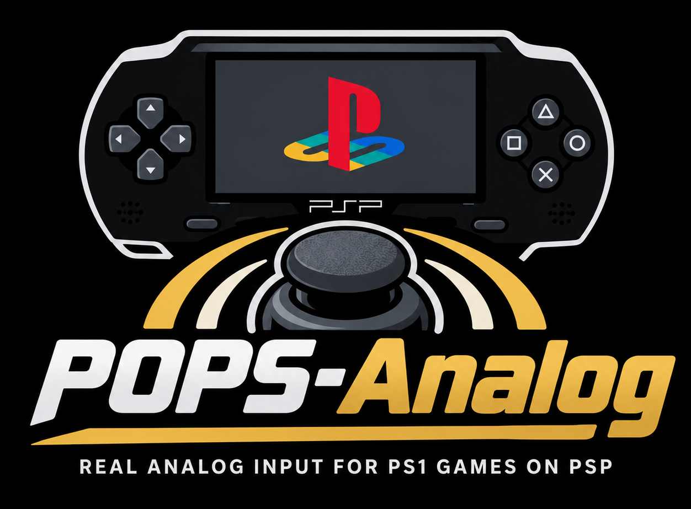

# POPS-Analog

A PSP plugin for POPS that adds *real* analog control, not just mapping the PSP's stick to the PS1's DPAD.

It also supports injecting data for the second analog stick and L2 / R2 buttons. This allows my [PSP Bluetooth Controller](https://github.com/ste2425/PSP-Bluetooth-Plugin) to provide full PS1 controller support.

If you are a developer that would like to support this too see Extra Data Developer Notes for more information.

   

    Demo of analog input in Spyro.
    

   

   

    Full controller support with my Bluetooth Controler Project.
    

   

  

  <video width="100%" height="240" controls>
    <source src="./assets/demo2.mp4">
  </video>
  

  

  <video width="100%" height="240" controls>
    <source src="./assets/demo1.mp4">
  </video>
  

---

## Installation

* Download `pops_analog.prx` from the [Latest Release](https://github.com/ste2425/POPS-Analog/releases/latest) and place it in `/SEPLUGINS`
* Update the `PLUGINS.TXT` file and add the following line to the bottom
  * `pops, ms0:/seplugins/pops_analog.prx, 1`
* Save then safely unmount the PSP.

If you run this please contact me with the details from the `Known Working Environments` table and i will update it.

## Known Working Environments

This plugin does *not* have a specific CFW requirement. 

However for 6.61 (not sure if 6.60 had this too) different motherboard revisions had their own version of POPS. The table below lists the combination of Official Firmware (OFW), Custom Firmware (CFW) and motherboard versions i have tested.

If you use this plugin please contact me with your motherboard version, OFW and CFW and i will update the table below.

| CFW | OFW | Motherboard Version |
| -- | -- | -- |
| LME-2.3 | 6.61 | TA-081v2 (01g) |
| ARK-4 | 6.61 | TA-081v2 (01g) |
| ARK-5 | 6.61 | TA-081v2 (01g) |
| ARK-5 | 6.61 | TA-088v3 (02g) |

## PS1 Controller Configuration

It is still possible to set custom controller configurations in POPS. However the PSP's analog stick will no longer be visible to POPS and is reserved solely for the PS1's analog stick.

## How It Works

## Left Analog Stick

POPS makes a call to `sceCtrlPeekBufferNegative` in a single place to get its data.

It finds, by NID, the specific MIPS `JAL` instruction that executes this and replace it with our own trampoline. This means the hook is reliable across multiple POPS versions.

The PS1's controller pad is stored in register `$s0` so the trampoline copies it to `$a2` meaning the patched `sceCtrlPeekBufferNegative` receives a pointer to it as its third argument.

## L2/R2

POPS when setting PS1 button data overwrites what is there, and it does this after executing `sceCtrlPeekBufferNegative`. So our hook created for the `Left Analog Stick` cannot set the L2/R2 data.

Instead we find where POPS exists the function that sets PS1 controller data, modify the exit jump to a syscall patch. The patch then sets the correct PS1 pad data. The trampoline then jumps back to the original exit address back into POPS.

## Extra Data Developer Notes

### L2/R2

Data for L2 and R2 is read from `sceCtrlPeekBufferNegative2` with `SCE_CTRL_LTRIGGER` and `SCE_CTRL_RTRIGGER` bitmasks.

You patch this method or execute [sceCtrl_driver_E467BEC8](https://github.com/uofw/uofw/blob/28306bb5bd4fcdcc0c1d469bf1f3bdb885dde3e9/src/kd/ctrl/ctrl.c#L902) to register a `SceCtrlInputDataTransferHandler` for the DS3 data port which will cause data to be available to `sceCtrlPeekBufferNegative2` naturally. As in not by hooking and forcing it.

See [PSP-EmulatedControllerTest](https://github.com/crozone/PSP-EmulatedControllerTest) repository for an example of `sceCtrl_driver_E467BEC8` usage. 

### Right analog stick

POPS reads data from `sceCtrlPeekBufferNegative`. If you ensure this methods sets the [rX / rY](https://github.com/uofw/uofw/blob/28306bb5bd4fcdcc0c1d469bf1f3bdb885dde3e9/include/ctrl.h#L35) fields this plugin will make the right stick work.

# Acknowledgements

* PSP Homebrew Discord community. Without their help i would never have been able to achieve anything on the PSP.
* ARK-5 developers. Without Ark5 non of this would work
* Special thanks to GrayJack. Spent allot of time in the Homebrew Discord explaining techniques for hooking the `sceCtrlPeekBufferNegative` call and showed me a way far better than i was attempting.

# AI usage

Im not getting into the AI debate but i know some have strong opinions on th subject.

So to be clear AI did not write this plugin, i did. I have used AI tooling as stated below.

* Making the logo, im not a designer. If a human would like to make a logo for this project i would love to use that instead.
* Reversing the `POPS_XYZ.prx`. AI was used to understand how POPS converts the PSP controller buffer data to PS1 data. I could have used Ghidra and learnt that sure. However this project was a short break from my main Bluetooth Controler project. I didn't want to embark on learning how to R/E things and understand Ghidra etc.